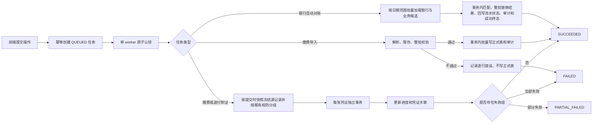

# 财务长耗时操作异步任务改造

## 1. 财务业务规则

1. 缴费登记导入继续执行严格整批校验：任一行校验失败，整批不写入正式业务表，并保留逐行错误明细。
2. 导入文件先保存到非 Web 目录，校验 SHA-256 后由后台工作进程解析；文件内容不写入任务 JSON，也不通过任务查询接口返回。
3. 缴费、退付批量制证仍遵守有借必有贷、借贷必相等、科目及辅助核算必填、期间开放、凭证号唯一等既有规则。
4. 一张完整凭证是最小事务单元。凭证头、分录、辅助核算值、业务源状态回写、任务明细和审计日志必须在同一事务中成功或回滚。
5. 多张凭证之间允许独立提交：某一组失败不会回滚已经成功的其他组，任务终态记为 `PARTIAL_FAILED`，失败记录可逐条查询。
6. 任务以 `account_set_id + job_type + client_request_id` 幂等，并同时校验业务载荷指纹或导入文件 SHA-256；同一个请求 ID 不允许改传另一份文件或数据范围。
7. 后台执行时重新校验提交人的权限；权限已撤销则拒绝执行。普通用户只能查看自己的任务，具备全账套视图权限的人员可查看本账套任务。
8. QUERY 制证以任务提交时间作为数据上界，排队期间新增记录不纳入本任务；低配置生产环境单任务最多冻结 5,000 条，超过时提示缩小查询范围。缴费导入文件上限为 10MB，并同时限制 BIFF 记录、共享字符串、行数和单元格数，任一超限都必须拆批导入。
9. 任务头 `period` 只表示提交时的会计上下文和任务归档月份；QUERY 制证必须按页面显式日期范围等当前查询条件取数，不能用任务头月份暗中收窄跨月或全年范围。源数据仍按各自业务日期生成到对应会计期间。
10. 银行自动对账按账套和页面显式日期范围整批重算。旧结果软删除、新结果写入、银行流水状态回写、审计日志以及任务 `SUCCEEDED/result` 终态必须在同一事务提交；任务失败时整批回滚，不允许留下部分新结果，也不允许出现“业务已成功、任务却显示失败”的状态歧义。页面选择的银行只用于提交意图和审计，当前结果表没有银行编码，因此实际仍按日期范围重算本账套全部银行。

## 2. 数据库结构

升级脚本：

- `backend/database/2026-08-03-finance-async-job.sql`：任务、任务明细和导入暂存表。
- `backend/database/2026-08-03-case-fund-async-voucher-query-index.sql`：缴费、退付 QUERY 制证组合索引。
- `backend/database/2026-08-03-case-fund-bank-reconcile-query-index.sql`：银行流水、业务候选和对账结果重算范围组合索引。

- `fin_async_job`：任务头、状态、进度、心跳、幂等号、文件元数据和最终结果。
- `fin_async_job_item`：冻结业务源记录，记录每条成功、失败、错误和关联凭证。
- `fin_case_fund_import_stage`：保存导入原始行、标准化行、校验结果和落库结果；正式表写入前必须完成整批校验。

三个脚本均不删除或改写既有财务业务数据，可重复执行。两个索引补丁使用
`ALGORITHM=INPLACE, LOCK=NONE`，等值范围列在前、业务日期和来源行号在后，避免
大范围取数产生文件排序；上线前仍应确认生产 MySQL 版本和可用磁盘空间。

银行对账索引严格跟随现有自动对账 SQL：先按账套、年度和有效标记限定数据，
再按交易日期读取银行流水及缴费、退付、未认领款候选；结果表分别覆盖自动匹配
范围软删除和按银行流水读取有效关联。`period` 不进入这些组合索引，避免跨月对账
被任务提交月份误收窄。索引只优化取数和结果替换，不改变流水号、账号、金额及
重复匹配等既有对账规则。

## 3. 流转流程



浏览器关闭进度窗口不会取消任务。前端按账套、用户和年度保存未完成 `job_id`；创建响应不确定时还会保存 `client_request_id + job_type`，重新进入页面后先查询原任务再恢复轮询。

## 4. 后端接口

| 接口 | 权限 | 说明 |
|---|---|---|
| `/caseFund/jobCreate` | 按任务类型检查导入、制证或对账权限 | 幂等创建任务并尝试启动 worker |
| `/caseFund/jobStatus` | `case_fund:view` | 查询单个任务公开状态，不返回 payload、文件路径或 worker token |
| `/caseFund/jobList` | `case_fund:view` | 按账套、年度和用户范围分页查询任务 |
| `/caseFund/jobErrorList` | `case_fund:view` | 查询任务逐条失败明细 |

当前任务类型：

- `CASE_FUND_PAYMENT_IMPORT`
- `CASE_FUND_PAYMENT_VOUCHER`
- `CASE_FUND_REFUND_VOUCHER`
- `CASE_FUND_BANK_RECONCILE`

当前任务状态：

- `QUEUED`
- `RUNNING`
- `SUCCEEDED`
- `PARTIAL_FAILED`
- `FAILED`

## 5. 生产部署

1. 先备份数据库，再依次执行任务表补丁、QUERY 制证索引补丁和银行对账索引补丁；索引创建安排在维护窗口，并确认在线 DDL 成功。
2. 确保 PHP 运行账户可写 `backend/runtime/finance_async_jobs`。
3. Web 请求会尝试拉起后台 worker。若生产环境禁用 `exec`、`popen` 或 `cmd /C start`，任务仍会安全保留为 `QUEUED`，界面会显示明确告警。
4. 低配置服务器只运行一个 worker；CLI 脚本使用 `flock` 防止同机并行消费，竞争锁时会短暂重试以覆盖旧 worker 退出窗口。不要通过增加大量并行进程换取速度，否则会放大数据库锁竞争和凭证号冲突。
5. 必须配置每分钟计划任务或常驻进程兜底。Web 自动拉起只用于降低等待时间，不能替代可靠的生产调度。
6. worker 预留致命错误收口内存；若仍发生 PHP 内存耗尽，会释放预留空间、回滚所有 TP5 嵌套业务事务并刷新数据库连接。银行对账在最外层事务提交前发生 fatal 时，业务和成功终态一起回滚，随后任务置为 `FAILED`；若最外层事务已经提交，则保留与业务数据共同持久化的 `SUCCEEDED`，不得反向覆盖为失败。其他任务仍按原 worker token 收口，避免长期停留在 `RUNNING` 后被反复接管。应根据失败提示缩小日期范围或拆分导入文件，不要直接提高并发数。

任务范围和任务明细均分批读写：正式凭证明细/辅助值使用批量插入，任务源记录按
500 条批量冻结、批量更新状态；BIFF 记录也会边消费边释放。每一张凭证仍保持独立事务
和完整审计，不因批量优化破坏凭证头、分录、辅助核算、源状态之间的原子性。

银行自动对账把原先随流水和业务记录数量增长的逐条候选查询改为四次窄字段范围预取，
匹配在内存索引中完成；结果每 200 条批量插入，流水状态每 500 条按状态迁移批量回写。
这些优化只减少 SQL 往返和峰值复制，不改变原有流水号、账号、金额差异、重复候选和
业务未匹配判定。

Linux 可用 cron 每分钟兜底运行：

```bash
* * * * * /usr/bin/php /path/to/backend/scripts/finance_job_worker.php >> /path/to/backend/runtime/finance_async_jobs/worker.log 2>&1
```

Windows/XAMPP 可在任务计划程序中每分钟运行：

```text
C:\xampp\php\php.exe C:\path\to\backend\scripts\finance_job_worker.php
```

脚本默认持续处理到队列为空，并可接管超过一小时无心跳的异常任务；正式业务事务会锁住任务头，防止接管期间两个 worker 同时提交同一张凭证。`--once` 表示本次最多处理一个任务；如需调整异常接管阈值，可显式传入 `--stale-seconds=秒数`。

## 6. 运维检查

重点监控：

- 长时间停留在 `QUEUED`：检查 PHP CLI 路径、后台启动权限或计划任务。
- 长时间停留在 `RUNNING` 且心跳停止：先确认旧 worker 是否仍在执行，再决定是否接管。
- `PARTIAL_FAILED` 或 `FAILED`：通过错误明细确认具体业务源，不要直接重复点击提交。
- 数据库慢查询：继续按真实 SQL 补充组合索引；延长 HTTP 超时时间只能作为临时兼容措施，不是本方案的完成条件。
